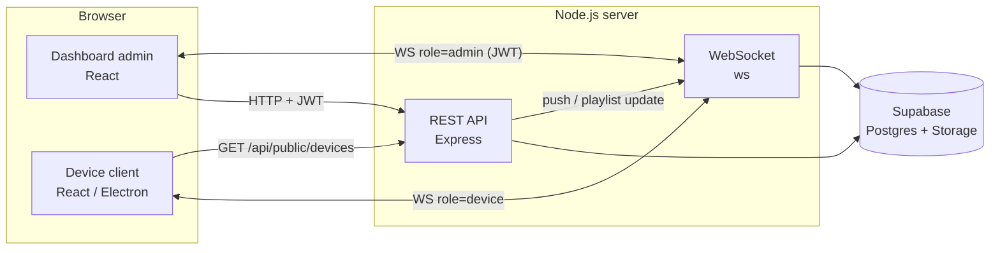

# Signage Control Panel

Aplikasi manajemen layar digital (digital signage) untuk technical test **Full Stack Developer, MJ Solution Indonesia**.
Admin mengelola perangkat, konten, dan playlist lewat dashboard. Status online/offline perangkat berubah **real-time lewat WebSocket**, tanpa refresh.

## Fitur

**Wajib**
- [x] Database Supabase (Postgres): tabel `devices` dan `contents` (plus `playlists`, `playlist_items`, `admins`)
- [x] REST API CRUD untuk devices dan contents
- [x] WebSocket server: status online/offline dikirim ke dashboard secara real-time
- [x] Dashboard admin: kelola device dan content, termasuk upload file (drag and drop) ke Supabase Storage
- [x] Halaman device client yang menampilkan konten (gambar, video, teks, tautan)

**Bonus**
- [x] Playlist device-content (urutan dan durasi per item) dan command push konten ke device tertentu
- [x] Device client sebagai aplikasi desktop (Electron, mode fullscreen/kiosk)
- [x] Autentikasi JWT untuk dashboard dan WebSocket admin
- [x] Reconnection di device client (exponential backoff, cache playlist offline) dan di dashboard

## Arsitektur



Alur status real-time: device membuka socket, server menandai `online` di database lalu mem-broadcast `device:status` ke semua admin. Saat socket putus (tab ditutup, jaringan mati, atau tidak membalas heartbeat), server menandai `offline` dan mem-broadcast lagi.

## Pilihan teknologi dan alasannya

| Bagian | Pilihan | Alasan |
|---|---|---|
| Database | Supabase Postgres | Relasional cocok untuk device, playlist, dan item. Storage bawaan dipakai untuk file upload. |
| Backend | Node.js + Express 5 | Ringan, async error handling bawaan, satu bahasa dengan frontend. |
| Realtime | `ws` (WebSocket native) | Protokol pesan, heartbeat, dan reconnect dikendalikan langsung, tidak tersembunyi di balik library. |
| Auth | JWT + bcrypt | Sederhana dan stateless. Token yang sama dipakai untuk REST dan WebSocket admin. |
| Frontend | React + Vite, CSS biasa | Build cepat, tanpa dependency UI tambahan. |
| Upload | multer (memory) → Supabase Storage | File tidak disimpan di disk server. |
| Desktop | Electron membungkus build device client | Satu basis kode untuk web dan desktop. |

Keputusan desain yang perlu diketahui:
- **Satu device = satu koneksi aktif.** Koneksi baru menggantikan yang lama, dan penutupan socket lama tidak menimpa status socket baru.
- **Heartbeat 15 detik.** Server mengirim `ping`; socket yang tidak membalas `pong` di putaran berikutnya di-terminate sehingga device ber-status offline walau koneksi putus tanpa sinyal close.
- **Reset status saat server start.** Semua device di-set `offline` agar tidak ada status online palsu setelah restart.
- **Dashboard memuat ulang data saat WebSocket tersambung kembali**, supaya update yang terlewat selama putus tetap tersinkron.
- **Service role key hanya ada di backend.** RLS aktif tanpa policy, jadi anon key tidak bisa mengakses tabel langsung.

## Cara menjalankan

Prasyarat: Node.js 18+ dan project Supabase.

### 1. Supabase
1. Buat project di [supabase.com](https://supabase.com).
2. Buka **SQL Editor**, tempel isi `supabase/schema.sql`, lalu **Run**. Ini membuat tabel dan bucket Storage `contents` (public).
3. Ambil **Project URL** dan **service_role key** di *Project Settings → API*.

### 2. Backend
```bash
cd server
cp .env.example .env      # isi SUPABASE_URL, SUPABASE_SERVICE_ROLE_KEY, JWT_SECRET
npm install
npm run seed              # membuat admin (default admin / admin123) + 2 contoh konten
npm run dev               # http://localhost:4000
```

### 3. Dashboard
```bash
cd dashboard
cp .env.example .env
npm install
npm run dev               # http://localhost:5173
```

### 4. Device client
```bash
cd device-client
cp .env.example .env
npm install
npm run dev               # http://localhost:5174
```

**Versi desktop (Electron):**
```bash
cd device-client
npm run electron          # build lalu buka fullscreen
npm run electron:kiosk    # mode kiosk
```

Atau dari root: `npm run install:all`, lalu jalankan `dev:server`, `dev:dashboard`, `dev:device` di terminal terpisah.

### Akun demo
`admin` / `admin123` (ubah lewat `ADMIN_USERNAME` dan `ADMIN_PASSWORD` di `server/.env` sebelum `npm run seed`).

## Cara mencoba (demo 2 menit)
1. Masuk ke dashboard, buka **Perangkat**, klik **Tambah perangkat**.
2. Klik **Buka layar** pada perangkat tersebut. Tab baru terbuka dan badge berubah **Online** seketika.
3. Tutup tab layar tersebut. Badge berubah **Offline** tanpa refresh.
4. Di **Konten**, unggah gambar/video atau buat konten teks.
5. Klik **Kirim konten** pada perangkat online. Layar langsung menampilkannya.
6. Di **Playlist**, susun beberapa konten, simpan, lalu pasang ke perangkat dari dropdown Playlist. Klik **Putar playlist** untuk kembali ke playlist setelah push.
7. Matikan backend sebentar. Layar menampilkan "Mencoba lagi", tetap memutar playlist tersimpan, lalu tersambung otomatis saat backend hidup.

Pada layar device, tekan **Shift + P** untuk memilih ulang perangkat.

## REST API

Semua endpoint selain `/api/auth/login`, `/api/public/*`, dan `/health` memerlukan header `Authorization: Bearer <token>`.

| Method | Path | Keterangan |
|---|---|---|
| POST | `/api/auth/login` | `{username, password}` → `{token}` |
| GET | `/api/auth/me` | Info admin |
| GET | `/api/public/devices` | Daftar `id, nama, lokasi` untuk pairing (tanpa auth) |
| GET / POST | `/api/devices` | List / buat. Body: `{nama, lokasi?, playlist_id?}` |
| GET / PUT / DELETE | `/api/devices/:id` | Detail / ubah / hapus |
| POST | `/api/devices/:id/push` | `{contentId}`, tampilkan konten sekarang → `{delivered}` |
| POST | `/api/devices/:id/resume` | Kembali memutar playlist → `{delivered}` |
| GET / POST | `/api/contents` | List / buat konten `text` atau `url`: `{judul, tipe, payload}` |
| POST | `/api/contents/upload` | `multipart/form-data`: `file`, `judul?` (gambar/video, maks 50 MB) |
| PUT / DELETE | `/api/contents/:id` | Ubah judul/isi / hapus (file di Storage ikut dihapus) |
| GET / POST | `/api/playlists` | List / buat |
| GET / PUT / DELETE | `/api/playlists/:id` | Detail / simpan `{nama, items:[{content_id, durasi_detik}]}` / hapus |

Kode status: `400` validasi, `401` tidak terautentikasi, `404` tidak ditemukan, `413` file terlalu besar, `502` upload storage gagal, `500` error server.

## Protokol WebSocket

Endpoint: `ws://host:4000/ws`

| Peran | URL |
|---|---|
| Device | `/ws?role=device&deviceId=<uuid>` |
| Admin | `/ws?role=admin&token=<jwt>` |

| Arah | Pesan | Fungsi |
|---|---|---|
| Server → Admin | `{type:"device:status", id, status, last_seen}` | Perubahan online/offline |
| Server → Admin | `{type:"device:playing", id, content}` | Konten yang sedang tayang di device |
| Server → Admin | `{type:"presence:snapshot", playing}` | Kondisi awal saat admin tersambung |
| Server → Device | `{type:"playlist:update", playlistId, items}` | Dikirim saat tersambung dan setiap playlist berubah |
| Server → Device | `{type:"content:push", content}` | Command tampilkan konten sekarang |
| Device → Server | `{type:"now_playing", content}` | Laporan tayangan saat ini |

Kode close: `4401` token admin tidak valid, `4404` device tidak ada atau dihapus (client berhenti reconnect dan kembali ke layar pairing), `4400` role tidak valid.

## Struktur proyek

```
server/            REST API + WebSocket
  src/routes/        auth, public, devices, contents, playlists
  src/realtime/      registry koneksi aktif
  src/services/      logika playlist
  src/middleware/    JWT, error handler
  src/ws.js          WebSocket server (heartbeat, status)
dashboard/         Dashboard admin (React + Vite)
device-client/     Layar device (React + Vite) + electron/main.cjs
supabase/schema.sql
```

## Batasan yang disadari
- Pairing device memakai endpoint publik read-only (`id, nama, lokasi`). Untuk produksi, ganti dengan kode pairing sekali pakai atau token per device.
- Penyimpanan item playlist dilakukan dengan hapus lalu sisip. Untuk produksi, bungkus dalam satu transaksi (RPC Postgres).
- Tautan (`url`) yang melarang embed lewat `X-Frame-Options` tidak akan tampil di iframe.
- Belum ada test otomatis.
